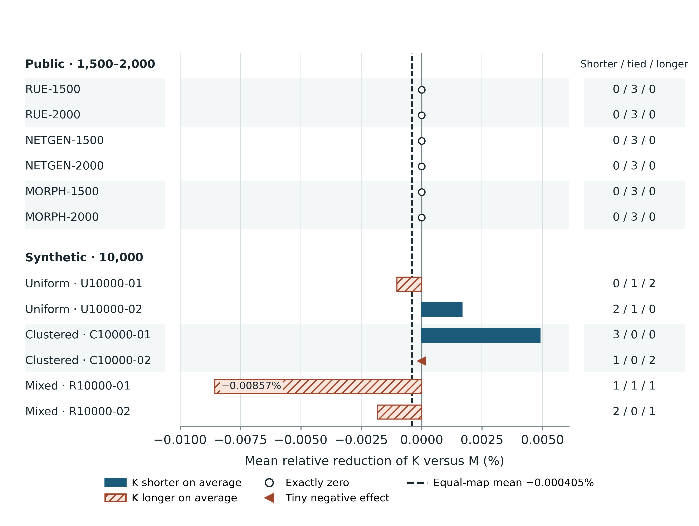

# When a Better Recombined Tour Does Not Yield a Better Final Tour: A Fixed-Budget Empirical Study of LKH-Based Search

Corresponding-author review draft · Minor scientific revision · Unsubmitted

## Abstract

We test whether three additional pairwise GPX2 recombinations improve the delivered tour for the symmetric Euclidean traveling salesperson problem under a fixed total time budget. Continuous LKH-derived search C starts from the instance. M continues from the best of three parent tours. K continues from the best eligible parent or offspring after recombining the same three parents. Both M and K pay the full cost of generating the shared parents. K also pays for recombination, selection and validation. In the local Windows R4 batch, 12 maps and three seeds per map yielded 36 groups with valid C, M and K tours. Against M, K was shorter in nine pairs, tied in 21 and longer in six. The map-equal mean reduction was −4.05 ppm, with an exploratory 95% map-level interval of [−22.41, 10.96] ppm spanning zero. Against C, K was 13/16/7 with a positive mean reduction of 33.27 ppm. The registered Holm-adjusted test did not support a difference at the 0.05 level (p = 0.125). Among 20 pairs with a shorter K start, K finished shorter in nine, tied in five and longer in six. Two author LKH configurations had budget non-deliveries, and the unified EAX comparison remains incomplete. The separately analyzed Windows CPU2 V22 batch (20 maps, five seeds per map) had positive K/M and K/C means of 29.30 and 34.76 ppm, respectively. These estimates apply to the tested configurations, instances and budgets.

**Keywords:** traveling salesperson problem; Lin–Kernighan–Helsgaun; partition crossover; fixed-budget optimization; reproducibility; non-delivery

## 1. Introduction

When a heuristic must deliver a complete tour by a fixed deadline, time devoted to creating and combining initial tours is time not available for later search. The Lin–Kernighan–Helsgaun (LKH) heuristic [1] and generalized partition crossover (GPX2) [2,3] are established approaches. They can be composed in many ways, but an improvement of the intermediate tour does not itself establish an improvement of the final delivered tour. GPX2 already supports recombination among LKH results, and earlier studies have considered both crossover inside LKH and feedback of improved solutions to search [2,3,4].

We compare three project-defined configurations rather than propose a new crossover. C starts independently from the instance, M selects the shortest of three parent tours and continues search, and K performs three additional pairwise GPX2 operations on that same pool before continuation. Necessary generation, selection, recombination, verification and delivery are charged to the appropriate method. We ask whether the additional three-pair preparation improves final tour quality relative to M under the same total budget. Secondary questions concern comparison with continuous C, registered author LKH configurations, and the relationship between starting and final quality.

This study contributes a same-parent comparison in which both M and K are charged for producing their shared parents, alongside separate reporting of route quality and delivery. It measures the net effect of K’s three additional recombinations and describes when a shorter selected starting tour did not retain its advantage at the deadline. The earlier V22 batch and the conditional old-pool diagnostic provide separately reported context. These observations apply to the recorded configurations and do not by themselves identify the cause of a reversal.

## 2. Related work

Helsgaun’s LKH implements the Lin–Kernighan heuristic [1]. LKH-2 extended k-opt submoves [5], and the LKH-3 report describes the later solver lineage [6]. Tinós, Helsgaun, and Whitley [2, Sections 4–5] compared GPX2 and IPT inside multi-trial LKH at preset trial and run counts and reported that better offspring did not necessarily improve the surrounding iterated local search. GPX2 has also been studied across separate runs [3], and Hains et al. [4] studied crossover on clustered TSP instances. Our paired contrast quantifies the net effect of three extra GPX2 calls on final delivered tours. Both methods use the same three-parent pool and pay its full cost under the same total wall-clock budget.

POPMUSIC has been used to construct LKH candidate edges using tour information [7]. Friedrich et al. [8] and Weise et al. [9] study fixed-budget bet-and-run strategies, including allocation of decision time and prediction; choosing among short initial searches is therefore not a new general strategy. Zhang and Looks [10] use backbone information from tours to guide LK search and perturbation. Our M is a concrete comparison configuration, not an invented bet-and-run framework. Recent candidate-list and partition-crossover studies [11,12] further limit any general novelty claim. McMenemy et al. [13] already compared LKH variants and EAX across a large set of structurally varied instances and investigated instance characteristics; their setting and budgets differ from ours. The present study differs operationally by recording the exact shared parent pool, charging its cost to both arms, and testing the *net* effect of three additional external GPX2 calls on delivered tours. Different implementations, benchmarks and deadlines prevent direct numerical comparisons with the cited studies.

## 3. Problem and comparison methods

For coordinates \((x_i,y_i)\), EUC_2D edge cost is \(d(i,j)=\lfloor\sqrt{(x_i-x_j)^2+(y_i-y_j)^2}+0.5\rfloor\). A feasible solution is a closed permutation of all cities, with length \(L(T)\) equal to the sum of its edges. Independent checks validate coverage, uniqueness, closure and length; they do not prove global optimality.

P5 is the project’s frozen Windows LKH-derived configuration. Its registered settings use POPMUSIC candidate generation, no subgradient ascent, five candidates per node and internal GPX2. Each M/K continuation starts a fresh P5-resume process. The selected tour is supplied through INITIAL_TOUR_FILE and candidate generation runs in that process. Supplementary Table S1 documents the settings and implementation scope.

* **C — continuous:** start from the coordinates and run the frozen strong P5 configuration, including its registered internal GPX2 use.
* **M — best parent:** generate three complete parent tours, select the shortest verified parent, and continue P5 from that tour. M does not make K's three *additional external* GPX2 calls; its underlying search retains its configured internal recombination.
* **K — three-pair recombination:** use the identical actual three-parent pool (P1, P2, P3), apply external GPX2 to the three pairs (P1, P2), (P1, P3) and (P2, P3), verify the resulting candidates, select the shortest legitimate parent or offspring, and continue with the same P5 continuation rules.

For the frozen configuration, the three parent seeds are \(s,s+1000,s+2000\), and M/K continuation uses \(s+3000\). A parent stage is capped at a nominal 17 seconds. Candidate selection retains a prior candidate on ties. The first actual working cycle of continuation is checked against the selected input. The method labels are local labels rather than standard names. The configuration, executable hashes and source-bound parameter records are listed in Supplementary Tables S1 and S2.

```text
Input: instance I, group seed s, frozen programs and parameters.
C: search from I; retain an eligible certified complete tour.
Generate and verify parent tours P1, P2 and P3 sequentially.
Record the necessary full common-prefix cost.
M: select the best parent; continue P5; charge the prefix and M's own work.
K: GPX2(P1,P2), GPX2(P1,P3), GPX2(P2,P3); verify candidates;
   select the best parent or valid offspring; continue P5;
   charge the prefix and all K-specific preparation and continuation work.
For each method: record and certify the eligible final complete tour and
its deadline, or retain the actual non-delivery or error status.
```

M and K physically reuse the same recorded parent pool, not three separately resampled parents. The full measured prefix is nevertheless invoiced to each method; K additionally pays its own GPX2, candidate selection and validation. Physical queuing and admission waiting are recorded separately, and M is not made to wait for K's recombination. The two continuation lengths may differ because the total budget, rather than the post-prefix search duration, is the controlled resource.

## 4. Experimental design and validity

### 4.1 Batches and execution

The earlier V22 batch was run on CPU2 using native Windows with an AMD EPYC 7T83 processor. It includes 20 fixed maps, five search seeds per map, and 100 C/M/K groups, for 300 valid method results. Its dataset comprises eight public research instances at 1,000–2,000 cities and twelve generated 10,000-city instances. CPU2 and later local results are not combined in a common test.

R4 used native Windows on a laptop with an Intel Core Ultra 9 275HX and about 47.38 GiB of system-visible memory. Each of 12 preselected instances used seeds 541, 761 and 981. The six generated 10,000-city instances comprise two uniform (U), two clustered (C) and two mixed (R) instances. In instance names, C identifies the clustered family. Supplementary Table S1 describes the generators. The six 1,500–2,000-city RUE, NETGEN and MORPH instances come from the Stirling collection [13]. The inputs use the TSPLIB EUC_2D convention [14]. Two previously exposed map–seed groups remain in the main analysis and are handled separately in the exposure sensitivity.

R4 ran serially with one search task at a time and the registered CPU0 affinity. M preceded K within each shared pool. Affinity specifies placement. Per-arm temperature, effective frequency and trial counts were unavailable for quantifying any order or thermal effect. The project P5, the LKH 3.0.14 Ascent64 builds and the Windows GA-EAX adaptation have separate version records.

The local R4 accounting protocol uses a 90-second total ceiling, search stopping/closing by 86 seconds, certified delivery strictly before 88 seconds, and final cleanup within 90 seconds. Necessary startup, input, initialization, parent production, recombination, continuation, validation and delivery are charged. Recorded discovery, observation, certification, stop and cleanup times are distinct. Admission waiting before a task and physical queueing are reported separately and do not give an in-progress task free continuation time. The earlier V22 protocol and its recorded timestamps are interpreted separately rather than overwritten to match R4.

### 4.2 Quality, failure and statistical analysis

For method X against reference Y, a paired percentage reduction is
\[
r_{X,Y}=100\frac{L(Y)-L(X)}{L(Y)}.
\]
Positive values favor X. Paired seeds are averaged within maps before giving maps equal weight. Reported effects use parts per million (ppm), with 1% equal to 10,000 ppm. Figure axes retain percent. Counts include non-deliveries and engineering failures, with tour-quality comparisons restricted to valid pairs.

R4 bootstrap intervals use 20,000 map-level resamples with the registered seed and percentile rule. They describe this fixed set of maps. The registered two-sided exact sign-flip tests require symmetry or exchangeability under the null. The five comparisons are K/M, K/C, K/LKH-GPX2, K/LKH-POP and K/EAX. Holm adjustment retains the full family, with the incomplete EAX contrast untested. Other comparisons and the leave-one-map and exposure checks are descriptive.

## 5. Results

### 5.1 Earlier CPU2 batch

V22 produced 300 valid C/M/K results with no recorded formal failures or retries. K/C was shorter/tied/longer in 36/38/26 of the 100 seed groups and had a map-equal mean reduction of 34.76 ppm; K/M was 44/41/15 with 29.30 ppm; M/C was 27/37/36 with 5.46 ppm. The earlier V23 audit used 20,000 map-level bootstrap resamples stratified by map family and reported 95% intervals of [12.52 ppm, 58.31 ppm] and [16.49 ppm, 41.84 ppm] for K/C and K/M, respectively. In 64 groups K's recombination start was strictly shorter than the best parent; final K/M outcomes in those groups were 44 shorter, five tied and 15 longer. These are CPU2 results under that batch's protocol, not observations that can be paired or pooled with local R4.

### 5.2 Local R4 C/M/K results

All C, M and K slots yielded valid routes on 12 maps and three seeds. Table 1 reports the map-weighted results. K was shorter more often than it was longer relative to M, but the longer outcomes had a larger average magnitude. The K/M interval crosses zero and the observed data do not demonstrate equivalence.

**Table 1. R4 complete paired route comparisons.**

| Comparison | Valid pairs / maps | Shorter / tied / longer | Map-equal mean (ppm) | Exploratory 95% interval (ppm) |
| --- | --- | --- | --- | --- |
| K/M | 36 / 12 | 9 / 21 / 6 | −4.05 | [−22.41, 10.96] |
| K/C | 36 / 12 | 13 / 16 / 7 | 33.27 | [7.45, 64.61] |
| M/C | 36 / 12 | 11 / 17 / 8 | 37.32 | [−0.18, 84.60] |

Supplementary Table S5 reports the four estimable registered tests and the incomplete EAX contrast. The estimable comparisons have six or seven nonzero maps, giving minimum two-sided sign-flip p-values of 0.03125 or 0.015625. Both exceed the first Holm cutoff of 0.01. The observed tie structure therefore prevented family-wise rejection at 0.05. M/C is calculated directly from its own pairs.

K/M has two positive, six zero and four negative means under the registered seed-relative metric. Its median map effect is zero. The largest individual improvement was 82.50 ppm and the largest regression was 285.80 ppm (139 length units on R10000-01/541). Leaving one map out yields means from −8.87 ppm to 3.37 ppm. The registered exposure sensitivity remains slightly negative. Both methods attained the published optimum in all 18 pairs on six 1,500–2,000-city instances [15]. On six 10,000-city maps, K/M was 9 shorter, 3 tied and 6 longer with mean reduction −8.10 ppm. This exploratory contrast confounds size with origin and structure. On C10000-02 the three absolute K/M differences sum to zero, but seed-specific denominators give the registered map mean a tiny negative sign. The supplementary sensitivity first computes each method’s mean within each map.



Figure 1. Mean R4 K/M reduction by map. Circles mark exact ties, the triangle a tiny negative effect, and the dashed line the equally weighted mean.

**Table 1a. R4 map-level means of paired seed reductions (ppm). The V242- prefix is omitted in display labels. Values near zero retain sufficient precision to show their sign.**

| Map | K/M | K/C | M/C |
| --- | --- | --- | --- |
| C10000-01 | 49.02 | −0.00058 | −49.02 |
| C10000-02 | −0.00018 | 40.54 | 40.54 |
| MORPH-1500 | 0.00 | 0.00 | 0.00 |
| MORPH-2000 | 0.00 | 0.00 | 0.00 |
| NETGEN-1500 | 0.00 | 0.00 | 0.00 |
| NETGEN-2000 | 0.00 | 0.00 | 0.00 |
| R10000-01 | −85.66 | 155.47 | 241.13 |
| R10000-02 | −18.48 | 58.17 | 76.64 |
| RUE-1500 | 0.00 | 0.00 | 0.00 |
| RUE-2000 | 0.00 | 14.12 | 14.12 |
| U10000-01 | −10.22 | 122.59 | 132.81 |
| U10000-02 | 16.73 | 8.37 | −8.37 |

### 5.3 Author configurations and delivery

**Table 2. R4 terminal status.**

| Method | Valid | Budget non-delivery | Resource-monitor interruption |
|---|---:|---:|---:|
| C | 36 | 0 | 0 |
| M | 36 | 0 | 0 |
| K | 36 | 0 | 0 |
| Author LKH-GPX2 | 29 | 7 | 0 |
| Author LKH-POP | 27 | 8 | 1 |

All 180 R4 slots for these five methods reached a terminal state, with 164 valid routes. Both author-LKH configurations delivered in zero of six runs on the two 10,000-city clustered maps. The twelve logs report completed ascent and 72.97–74.58 CPU s of preprocessing. These CPU times describe the burden of initial work. They do not locate the wall-clock cutoffs. This comparison uses the registered ALPHA/subgradient configurations and provides no controlled comparison with an author LKH POPMUSIC/no-subgradient configuration.

**Table 2a. Primary and secondary comparisons with valid deliveries in R4.**

| Comparison | Role | Valid pairs / maps | Shorter / tied / longer | Map-equal mean (ppm) | Exploratory 95% interval (ppm) |
| --- | --- | --- | --- | --- | --- |
| K/LKH-GPX2 | Primary | 29 / 10 | 17 / 10 / 2 | 242.25 | [65.63, 516.40] |
| K/LKH-POP | Primary | 27 / 10 | 13 / 14 / 0 | 316.30 | [76.88, 639.88] |
| M/LKH-GPX2 | Secondary | 29 / 10 | 17 / 10 / 2 | 247.80 | [64.60, 538.95] |
| M/LKH-POP | Secondary | 27 / 10 | 13 / 14 / 0 | 312.13 | [75.81, 632.85] |
| C/LKH-GPX2 | Secondary | 29 / 10 | 16 / 8 / 5 | 204.21 | [42.25, 450.16] |
| C/LKH-POP | Secondary | 27 / 10 | 13 / 12 / 2 | 259.30 | [68.96, 509.60] |

The first two rows report registered primary contrasts. The four secondary rows use the same valid-pair rule. Supplementary Table S5 gives the registered p-values.

The original R4 EAX arm used an adapted implementation of edge-assembly crossover [16]. It delivered 18 of 19 attempts on six large maps, with 17 slots deferred. Among the available pairs, M/EAX, C/EAX and K/EAX were shorter, tied or longer in 18/0/0, 16/0/2 and 17/0/1 cases. The separately versioned EAX supplement delivered 18, failed on one and left 17 unstarted. These partial records describe availability and observed valid pairs.

### 5.4 Starting tours and continuation

M and K parent hashes match in all 36 R4 groups. In 16 groups the selected starting cycles are identical up to rotation and reversal, and their final lengths tie. In the remaining 20 groups K starts shorter; it finishes shorter in 9, tied in 5 and longer in 6. On four of the small-map runs, K started at the published optimum while M reached it during continuation. Of the 16 strictly better K starts on the 10,000-city maps, 9 led to shorter endpoints, 1 to a tie and 6 to longer endpoints. No matched external optimum was established for these six large maps. Thus a shorter start did not guarantee the shorter final tour in these observed configurations. The per-group start and final differences are shown in Supplementary Figure S1; their association is descriptive and does not isolate a causal mechanism. It is not possible from this observation alone to attribute the six reversals uniquely to extra recombination time, route structure, initialization state, randomness or other search dynamics.

The three external GPX2 calls took 0.33 s on average. Available continuation allowances averaged 31.15 s for M and 30.88 s for K. On the larger maps the paired allowance difference (M minus K) ranged from −0.288 to +0.450 s. The allowance is computed after charged branch preparation. A longer measured M startup explains the most negative difference (Supplementary Table S3).

A separate 30-second diagnostic used 12 already-exposed development pools from six maps and three continuation seeds per pool (72 valid tasks). Start A was the shortest parent and start B was the tour selected by the historical K procedure. B finished shorter/tied/longer in 12/20/4 of 36 pairs. The 18 same-cycle pairs tied. Among the 18 pairs starting from different cycles, B started shorter and finished shorter/tied/longer in 12/2/4. A ran before B and the already-generated pools were supplied without charge. These repeat seeds characterize sensitivity in the development pools. R4 used different pools and one continuation seed per pool.

## 6. Discussion

The earlier positive mean in V22 and the slightly negative local R4 K/M mean show that the added recombination benefit is not established as stable across these two nonidentical batches. Neither comparison isolates hardware from dataset, time accounting and other differences, so the reversal of batch means should not be assigned to hardware alone. K/M has more shorter than longer seed pairs in R4 but a negative map-equal mean because the few regressions have larger magnitudes; the leave-one-map range includes both signs. Selecting only favorable maps or reporting seed-level wins as independent map-level evidence would obscure that result.

A shorter starting tour can still produce a worse final tour. Earlier bet-and-run and GPX studies raise related questions about trajectory and selection [3,8,9]. Our comparison measures the incremental effect of three external recombinations with a shared parent pool. The available records support several explanations, including elapsed preparation, candidate construction and stochastic search state.

The two author-LKH settings illustrate why delivered quality and delivery probability are separate outcomes. A budget failure applies to the tested setup and deadline. A configuration-matched author LKH baseline with POPMUSIC and no subgradient would be needed to isolate this aspect of the external comparison. The EAX records cover separate versions and remain an incomplete external comparison.

## 7. Limitations and future work

The selected benchmark has only 12 local maps, some previously exposed cases, three seeds per map and two principal scale ranges; inference to all Euclidean or non-Euclidean TSPs is not justified. The valid-pair external comparisons exclude maps without author-LKH deliveries. CPU affinity does not ensure processor isolation, and unrecorded temperature or exact internal discovery times must not be imputed. R4's two LKH configurations and the incomplete EAX supplement do not cover all strong baselines. Independent route validation verifies feasibility and objective value, not the internal correctness of every search operation or global optimality.

The supplementary execution record describes the incomplete independent confirmation and EAX comparisons. The separately planned 1,600-run study has started and completed zero formal runs. The 19,402-city EAX engineering test saved an independently verified candidate. The record lacks complete evidence that search stopped before the registered 86-second deadline, so the candidate contributes no observation to the performance comparison.

A follow-up that separates mechanism from end-to-end effect would combine same-total-budget runs with matched continuation windows or trial counts and repeated continuation seeds per shared pool. Randomizing paired execution order and logging search trajectories would help attribute variation. The current comparison estimates the incremental outcome of the combined procedure.

## 8. Conclusion

In R4, extra recombination improved the selected starting tour in 20 pairs and produced nine shorter, five tied and six longer endings within those pairs. Across the full 12-map batch, K’s mean final quality was slightly worse than M’s and the interval crossed zero. In V22 the K/M mean was positive under a different setting. Together these results motivate measuring delivered tours and preparation time directly when evaluating an extra heuristic stage.

## Reproducibility and declarations

The public numerical release contains 300 V22 records and 180 five-method R4 records with instance, seed, method, status, scored length and available timing fields. The paired effects, map-level quantities, registered tests and figures can be regenerated from the released records and supporting inputs. V22 used 20,000 stratified map resamples with PCG64 seed 20261112, with paired seeds averaged within maps. The four strata are public, uniform, clustered and mixed. Its two primary sign-flip tests use a Holm family separate from R4. R4 uses Python's random generator with seed 20261116 and 20,000 map resamples.

The [review repository](https://github.com/wang-d-c/TSP-SCI-Reproducibility-And-Evidence-20261118) includes fourteen attributed University of Stirling instances [13] and a script that reconstructs all eighteen project-generated instances byte for byte. A separate checker verified feasibility and EUC_2D length for the 464 historical valid tours (300 V22 and 164 R4). The saved city orders are supplied separately for authorized review. New timed C/M/K searches also require lawful access to the frozen solver components, their configurations and a compatible Windows execution and resource-control environment. The public release supports statistical replay and supplies coordinate inputs for authorized tour verification. Full solver reruns remain a separate capability.

## AI assistance

ChatGPT and Codex assisted research design, code development, analysis and manuscript preparation. The authors are responsible for the results, references and final text. The authors will confirm disclosure wording and placement against the selected journal policy before submission.

## References

1. Helsgaun, K. (2000). An effective implementation of the Lin–Kernighan traveling salesman heuristic. *European Journal of Operational Research*, 126(1), 106–130. https://doi.org/10.1016/S0377-2217(99)00284-2
2. Tinós, R., Helsgaun, K., & Whitley, D. (2018). Efficient recombination in the Lin–Kernighan–Helsgaun traveling salesman heuristic. *Parallel Problem Solving from Nature*, LNCS 11101, 95–107. https://doi.org/10.1007/978-3-319-99253-2_8
3. Tinós, R., Whitley, D., & Ochoa, G. (2020; online 2019). A new generalized partition crossover for the traveling salesman problem: Tunneling between local optima. *Evolutionary Computation*, 28(2), 255–288. https://doi.org/10.1162/evco_a_00254
4. Hains, D., Whitley, D., & Howe, A. (2012). Improving Lin–Kernighan–Helsgaun with crossover on clustered instances of the TSP. *PPSN XII*, 388–397. https://doi.org/10.1007/978-3-642-32964-7_39
5. Helsgaun, K. (2009). General k-opt submoves for the Lin–Kernighan TSP heuristic. *Mathematical Programming Computation*, 1, 119–163. https://doi.org/10.1007/s12532-009-0004-6
6. Helsgaun, K. (2017). An extension of the Lin–Kernighan–Helsgaun TSP solver for constrained traveling salesman and vehicle routing problems. Technical report, Roskilde University. https://forskning.ruc.dk/da/publications/an-extension-of-the-lin-kernighan-helsgaun-tsp-solver-for-constra/
7. Taillard, É. D., & Helsgaun, K. (2019). POPMUSIC for the travelling salesman problem. *European Journal of Operational Research*, 272(2), 420–429. https://doi.org/10.1016/j.ejor.2018.06.039
8. Friedrich, T., Kötzing, T., & Wagner, M. (2017). A generic bet-and-run strategy for speeding up stochastic local search. *AAAI Conference on Artificial Intelligence*, 31, 801–807. https://doi.org/10.1609/aaai.v31i1.10645
9. Weise, T., Wu, Z., & Wagner, M. (2019). An improved generic bet-and-run strategy with performance prediction for stochastic local search. *AAAI Conference on Artificial Intelligence*, 33, 2395–2402. https://doi.org/10.1609/aaai.v33i01.33012395
10. Zhang, W., & Looks, M. (2005). A novel local search algorithm for the traveling salesman problem that exploits backbones. *IJCAI*, 343–349. https://ijcai.org/proceedings/2005/182
11. Heins, J., Schäpermeier, L., Kerschke, P., & Whitley, D. (2024). Dancing to the state of the art? How candidate lists influence LKH for solving the traveling salesperson problem. *PPSN XVIII*, LNCS 15148, 100–115. https://doi.org/10.1007/978-3-031-70055-2_7
12. de Carvalho, O. Q., & Whitley, D. (2025). Dramatically faster partition crossover for the traveling salesman problem. *GECCO ’25*, 818–826. https://doi.org/10.1145/3712256.3726465
13. McMenemy, P., Veerapen, N., Adair, J., & Ochoa, G. (2019). Rigorous performance analysis of state-of-the-art TSP heuristic solvers. *EvoCOP*, LNCS 11452, 99–114. https://doi.org/10.1007/978-3-030-16711-0_7. Associated dataset record: https://datastorre.stir.ac.uk/handle/11667/127 (CC BY 4.0 for the 14 included instance files).
14. Reinelt, G. (1991). TSPLIB—A traveling salesman problem library. *ORSA Journal on Computing*, 3(4), 376–384. https://doi.org/10.1287/ijoc.3.4.376
15. Kerschke, P., Kotthoff, L., Bossek, J., Hoos, H. H., & Trautmann, H. (2018). Leveraging TSP solver complementarity through machine learning. *Evolutionary Computation*, 26(4), 597–620. https://doi.org/10.1162/evco_a_00215
16. Nagata, Y., & Kobayashi, S. (2013). A powerful genetic algorithm using edge assembly crossover for the traveling salesman problem. *INFORMS Journal on Computing*, 25(2), 346–363. https://doi.org/10.1287/ijoc.1120.0506
