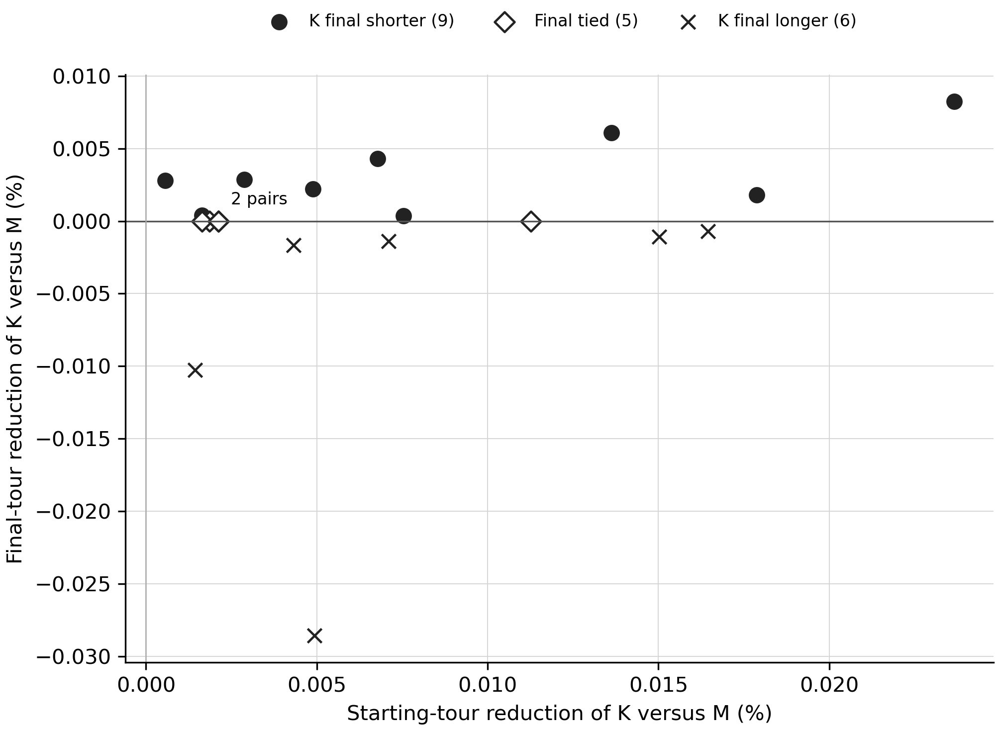

# Supplementary methods and recorded costs

Tables S1–S3 describe the frozen R4 methods and timing records. Table S4 compares archived endpoint lengths with published values for byte-identical public instances. Cost distributions and optimum attainment are post hoc descriptions. V22 used a different machine, protocol and GPX2 executable and is reported separately. The data-access statement in the main paper distinguishes the public source data from the project materials and third-party software that require further permission.

## Supplementary Table S1. Methods and execution settings

| Item | Recorded specification |
|---|---|
| C | Start with the input coordinates and run the project P5 configuration. Its configured internal recombination is GPX2. |
| M | Generate and validate parents P1, P2 and P3; select the best valid parent; continue P5 from it. P5 retains internal GPX2; M does not perform K's three additional external GPX2 calls. |
| K | Use the same physical parent pool as M, recombine (P1,P2), (P1,P3) and (P2,P3), validate candidates, select among the valid parents and offspring, and continue P5. The actual pair labels in the code are AB, AC and BC. |
| Parent sharing and charging | The shared generation and required preparation are charged in full to each arm. K separately pays for its extra recombination, selection and validation. M does not wait for K's recombination. |
| Seeds | For group seed `s` in {541, 761, 981}, the parent seeds are `s`, `s+1000` and `s+2000`; M and K continue with `s+3000`. |
| Parent limit | Each parent has a nominal 17-second limit, also subject to the global stop-request deadline. |
| Representative P5 parameters | `CANDIDATE_SET_TYPE=POPMUSIC`, `POPMUSIC_SOLUTIONS=25`, `MAX_CANDIDATES=5`, `SUBGRADIENT=NO`, `MOVE_TYPE=5`, `SUBSEQUENT_MOVE_TYPE=5`, `BACKTRACKING=NO`, `PATCHING_C=0`, `PATCHING_A=1`, `RECOMBINATION=GPX2`, `POPULATION_SIZE=0`, `RUNS=1`, `MAX_TRIALS=100000`, `STOP_AT_OPTIMUM=NO`, `GAIN_CRITERION=YES`. |
| Author LKH common configuration | LKH 3.0.14 Ascent64-compatible build; `CANDIDATE_SET_TYPE=ALPHA`, `MAX_CANDIDATES=5`, `SUBGRADIENT=YES`, `ASCENT_CANDIDATES=50`, `MOVE_TYPE=5`, `PATCHING_C=3`, `PATCHING_A=2`, `RECOMBINATION=GPX2`, `RUNS=100000`, `PRECISION=100`, `STOP_AT_OPTIMUM=NO`, `GAIN_CRITERION=YES`. |
| Author LKH-GPX2 | `POPULATION_SIZE=0`; `MAX_TRIALS=DIMENSION` (10000 in the checked 10,000-city parameter file). |
| Author LKH-POP | `POPULATION_SIZE=10`, `MAX_TRIALS=10`; the registered account describes native ERXT crossover and GPX2 merging. |
| Outer budget | Windows, one search task at a time, registered CPU0 affinity; 90-second total ceiling, search stopping/closing by 86 seconds, certified delivery strictly before 88 seconds and cleanup within 90 seconds. Affinity does not establish exclusive access to a physical core. |
| Inner time-limit fields | The inspected native parameter files set `TIME_LIMIT=86400`, and author LKH also `TOTAL_TIME_LIMIT=86400`; these are subordinate to the outer deadline and do not provide an additional budget. |

P5 values above were checked against the existing C `V244_V242-U10000-02_s761_C_project_a01/w/C/solver/run.par`, third-parent `V242-U10000-02_s981/task/prefix/pool_3/run.par`, and recorded M/K resume examples in `method_config_examples.json`; author LKH values were checked against the two actual C10000-01/541 `parameters.par` files. These are documented examples; individual run files and receipts remain the authority for each task.

## Supplementary Table S2. Selected R4 version hashes

| Component | SHA-256 | Scope |
|---|---|---|
| P5.exe, positive-coordinate binding | `d829cc485d1b6c454af3b1274a9be2ceb37b08ce946bf39b7bbfccde380962c1` | Local hashes of the C runtime and M/K positive runtime match. |
| P5-resume.exe, positive-coordinate binding | `f70cca81bb143f39f56f6935d5d207c8c527ac2ecaa6a26aaaa24a66c816c35e` | Local file matches the M/K plan. |
| native GPX2 | `61e4ba2c4123f83bdf4d4cd06f0433aa9c9aa9f63ce249a6a1cb9c4572ee336e` | R4 plan records this executable. |
| LKH 3.0.14 Ascent64-compatible executable | `bc7863ed0cb0f3417d7dc02a756609dbd6d5f3baa0b9d8983d9857fb755907f3` | Not a byte-identical unmodified author release. |
| M/K shared-prefix driver | `12b90fc15b3eb642f4e86b81c6692dced340d684291ef4658ebb44da16019a3d` | `prefix_v19_a07.py`; recorded in R4 admission. |
| M/K arm driver | `e48a0a2ace5b8107f5a3b7592bcb6e4c0125e6a4568b20be0d9b692983b62520` | `arm_v19_a07.py`; recorded in R4 admission. |
| Shared execution core | `e6221c4f199d067a904d538f03fe297eabcde646bf24eaa069d9a5030c66e31b` | `shared_core.py`; recorded in R4 admission. |

Separate negative-coordinate-compatible binaries also exist and have different hashes; their presence does not establish that every R4 run used them. The M/K static R4 binding points to the positive-coordinate runtime and requires upstream checks. Run-specific binary evidence must be used for any per-instance claim. Limited integer-range and negative-coordinate tests are not a proof of safety for all internal paths. The companion version_hashes.csv supplies each digest as a single uninterrupted string.

The author LKH Ascent64 build receipt records GCC executable SHA-256 `e47ff11a48f1dd4546a0e5ae14913ea582f0c77a4c9a48ceb35ad8d2880fe27d` and compilation commands including `-O3 -std=gnu99 -fcommon -DTWO_LEVEL_TREE -march=native -ffp-contract=off`; the local toolchain record reports GCC 16.2.0. The V22 P5 build is also recorded with GCC 16.2.0 and those nominal options, but `-march=native` and machine/toolchain details prevent assuming byte-identical output on a different computer.

### Example parameter-file hashes

These hashes include the original path fields and identify the specific files, not a universal configuration. M and K use different paths, so their file hashes differ even though the checked non-path parameter fields and seed match. The actual parameter files are not redistributed here without rights review.

| Recorded example | SHA-256 |
|---|---|
| C, U10000-02 / 761 `run.par` | `e39ab2319f0fb1e21da0978ab1abc3c99bc307fa550e0f4aa39b2d2efa5393cc` |
| Third parent, U10000-02 / 981 `run.par` | `734b040f0c97f346fb20a9c4a48adcdafad4e13075f32177f8a75a18b52af786` |
| M continuation, U10000-02 / 981 `resume.par` | `4f9e21fe21aa220d4fc9bc49aa3c85134149a96e55a37c8e93824dbc2483dfc8` |
| K continuation, U10000-02 / 981 `resume.par` | `ac9915f812bf7d287c621b9e778ec664050c8cfdf43449e92720338249a337f5` |
| LKH-GPX2, C10000-01 / 541 `parameters.par` | `7a7438a669972a507f457beee784c3dd851df62131017231a4b9e8876d870848` |
| LKH-POP, C10000-01 / 541 `parameters.par` | `2346fb5d26dd1ffba11871caa7a68c631308679bfe2c7e9333bc121e5cd3cc4c` |

## Supplementary Table S3. Recorded time fields in the 36 R4 M/K groups

Each field has 36 observations. Values are arithmetic means in seconds. Available continuation time is an allowance. The commit timestamp is elapsed charged time. Adding these fields would count some time twice.

| Recorded field | M | K | Interpretation |
|---|---:|---:|---|
| `prefix_paid_s` | 53.086230 | 53.087202 | Each arm is charged for the shared prefix; these fields include required preparation and are not pure solver CPU time. |
| `pair_wall_s` | Not applicable | 0.328780 | K's recorded three-pair GPX2 wall interval; range 0.218216–0.507295 seconds. |
| `resume_available_budget_s` | 31.152158 | 30.880452 | Recorded available continuation budgets, not CPU time, actual exit or discovery times. |
| `commit_paid_s` | 85.888942 | 85.889414 | Recorded paid certification/commit time, not the instant when the best solution was first discovered or a process exited. |
| Independent selection and validation subcosts | Unknown | Unknown | The records do not provide complete, separately timed costs that may be combined into a full component breakdown. |

The available continuation-time difference includes preparation and validation as well as recombination; it must not be attributed wholly to GPX2 by subtraction. Source: the 36-row `km_mechanism/results/36组起点成本终点.csv`; definitions, hashes, sample parameter-file locations and caveats are documented in the companion Chinese audit. Across 18 small-map pairs, the recorded time for the three GPX2 calls had a median of 0.264 s (quartiles 0.236–0.276 s). Across 18 large-map pairs the median was 0.398 s (0.361–0.411 s). The median paired M minus K continuation allowance was 0.219 s for the small maps and 0.348 s for the large maps. Among the large maps the differences ranged from −0.288 to 0.450 s, so K did not always enter continuation with less time.

## Supplementary Figure S1. Starting and final tour differences

**Supplementary Figure S1.** Starting- and final-tour reductions of K versus M for the 20 R4 map–seed pairs in which K selected a strictly shorter starting tour. Positive final reductions favor K; one plotted position represents two pairs. The remaining 16 pairs had identical undirected starting cycles and tied final lengths and are omitted from this plot. The comparison is post hoc and does not identify the cause of final differences. Source: `05_图表与分析/Figure_2_36_pairs.csv`.

## Supplementary Table S4. Endpoints attaining the published optimum on the six public R4 maps

Each entry counts the runs that attained the published length among the three registered seeds. All five methods delivered a valid tour in each of these 18 R4 map–seed groups. These maps were matched after the main analysis.

|Map|Optimum|C|M|K|LKH-GPX2|LKH-POP|
|---|---|---|---|---|---|---|
|MORPH-1500|18,533,583|3/3|3/3|3/3|1/3|3/3|
|MORPH-2000|21,099,918|3/3|3/3|3/3|0/3|1/3|
|NETGEN-1500|9,149,713|3/3|3/3|3/3|3/3|3/3|
|NETGEN-2000|9,852,725|3/3|3/3|3/3|0/3|1/3|
|RUE-1500|28,369,732|3/3|3/3|3/3|3/3|3/3|
|RUE-2000|32,633,059|1/3|3/3|3/3|3/3|3/3|
|All six|—|16/18|18/18|18/18|10/18|14/18|

The coordinates, city IDs, dimension, distance type and input-file SHA-256 matched the benchmark files. Reference lengths come from the authors’ instance-specific .opt files; Kerschke et al. [13, Section 3.3] report using Concorde. The locally certified tour lengths were compared with these published numbers. No exact solve or verification of a Concorde proof certificate was performed here.

In V22, eight different public maps supplied 40 valid routes per arm. C attained the corresponding optimum in 37 runs, M in 36 and K in 39. These results are reported separately from R4. The 18 project-generated maps across the two batches have no matched external reference in this analysis.

Companion data record all 14 reference values and 210 valid historical route comparisons. For a valid tour of length L and published optimum O, the percentage gap is 100 × (L − O) / O. A zero gap says nothing about when the optimum was first found.
