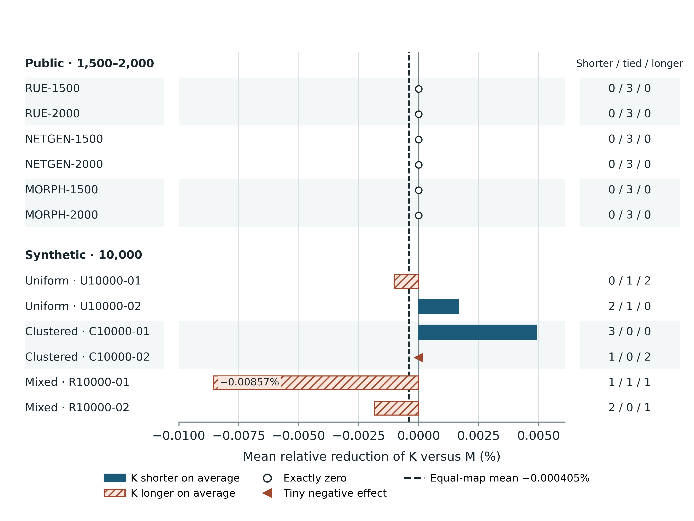

# 固定时间预算下多路线重组与续搜的净收益：对 LKH 派生旅行商启发式的配对经验研究

中文审阅稿。当前修订同步了统计分辨率、成本解释、图表和资料入口。作者、单位、资助、利益冲突与通讯作者信息由真实作者确认。

## 摘要

在固定时限内，旅行商启发式既要产生较短路线，也要在预算内完成合法性认证和交付。本文研究将额外路线重组加入已有多起点林—克尼汉—赫尔斯高（LKH）派生求解流程的净效果。我们比较三种方法：从坐标连续搜索的 C、从三条父环中择优续搜的 M，以及使用相同父池、额外执行 P1/P2、P1/P3、P2/P3 三对广义分区交叉 GPX2 后择优续搜的 K。两种父池方法各自承担完整父环生成费用，K 另支付重组、验证与写出费用。历史 V22 批次在 Windows CPU2 上以 20 张地图和五个种子获得 100 组 C/M/K 有效结果；其地图等权平均相对缩短率，K 对 M 为 0.002930%，K 对 C 为 0.003476%。本机 Windows R4 的五方法部分覆盖 12 张地图、每图三个种子，共 180 项终态，其中 C/M/K 的 36 组全部构成有效配对：K 对 M 为 9 短、21 平、6 长，地图等权平均缩短 −0.000405%，探索性 95% 地图级自助区间为 [−0.002241%, +0.001096%]；K 对 C 为 13 短、16 平、7 长，平均 +0.003327%，预登记多重比较校正后的 p 值为 0.125。M 对 C 为 11 短、17 平、8 长，平均 +0.003732%。R4 中 20 组 K 以更短环开始续搜，却仅有 9 组以比 M 更短的环结束，另有 5 平、6 长。两种作者 LKH 配置存在预算未交付，统一版本 EAX 对照未完成。结果表明，更好的起点不一定在相同预算下转化为更好的终点；在本批条件下，K 相对 M 的稳定平均净增量未得到支持，也不能据此证明两者等价。本文贡献是明确共享父池、完整计费、保留缺失和独立复核的经验对照，而非新交叉算子或全局最优性证明。

**关键词：** 旅行商问题；LKH；GPX2；固定预算；多起点；路线重组；可复现经验研究。

## 1. 引言

对称旅行商问题要求给定城市各访问一次并回到起点，最小化完整环长度。LKH 使用候选集与可变深度交换搜索，在大规模 TSP 上具有影响力 [1]。增加初始路线或重组操作可能改善启发式的起点，但也会占用后续搜索和交付时间。因此，仅比较重组后的中间解，不能说明其在固定总预算下的实际价值。

我们研究两个预先确定的问题：在相同实例和名义总预算下，额外三对 GPX2 整理相对共享父池的最短父环续搜是否产生净终点收益？其改善的起点有多少能保留到终点？连续搜索 C 用于提供完整方案相对基础配置的参照，两种作者 LKH 配置用于限定外部比较范围。除历史 V22 批次外，本机 R4 的 12 图比较构成第二批实证数据。两组在验收期间已暴露的图—种子组合必须披露，不能称全部组合均为未见数据。

可主张的工作包括：（1）记录方法实现、父池共享与分别计费语义，使重组增量与多起点基础配置得到直接对照；（2）分别呈现路线质量、预算内未交付和程序或资源中断，并按地图聚合统计；（3）追踪相同父池下的续搜起点与终点，量化条件下的改善保留与反转。已有研究涉及多起点、路线重组和改善起点后的继续搜索。因此，上述贡献属于具体条件下的经验认识与实验设计，而非对这些一般机制的首次发现。

## 2. 相关工作

Helsgaun 的 LKH 将候选边与交换搜索结合 [1]。LKH-2 扩展了 k-opt 子动作 [14]，LKH-3 技术报告描述了后续求解器 [15]。Tinós 等已在多 trial LKH 和多次运行中研究 GPX2 [2,3]，Hains 等讨论了聚簇实例上的交叉 [4]。本文沿用这些技术，测量在同一父池和交付时限下增加三次外部重组的净差异。

固定预算下以多个短运行选择后续对象，与 bet-and-run 思路有直接联系。Friedrich 等提出通用 bet-and-run 策略并包含旅行商局部搜索案例 [5]；Weise 等研究使用性能轨迹预测后续运行，并将决策成本纳入时间预算 [6]。本文 M 是针对给定 P5 配置和三个父环的一种实证基线，不是对 bet-and-run 的首次提出；本文也不实现性能预测器。Zhang 与 Looks 已利用多条局部最优路线的 backbone 信息偏置 LK 搜索和扰动 [7]，Taillard 与 Helsgaun 将 POPMUSIC 和路线信息用于 LKH 候选生成 [8]。因此，对基于父环的信息反馈或候选访问次序的一般原创性表述应有所限定。

作者 EAX 是重要外部路线求解基线 [9]；完整统一版本比较在本研究中尚未完成，因此不将其程序执行失败解释为算法路线质量败绩。后续 GPX3 的分区交叉实现 [10] 与本实验有联系，但本批未测 GPX3，不能据文献中的结果推断它与本文方法的同预算排名。

## 3. 问题、方法及开销

给定二维整数坐标 $p_i=(x_i,y_i)$，EUC_2D 距离为 $d(i,j)=\lfloor\sqrt{(x_i-x_j)^2+(y_i-y_j)^2}+0.5\rfloor$；闭环 $T=(t_1,\ldots,t_n)$ 的长度是 $L(T)=\sum_{i=1}^{n}d(t_i,t_{i+1})$，其中 $t_{n+1}=t_1$。有效路线必须包含全部城市恰好一次，并可闭合成环。独立验环与计长验证的是路线合法性及长度，并不证明全局最优。

P5 是项目冻结的 Windows LKH 派生配置，使用 POPMUSIC 候选集、关闭次梯度上升，保留内部 GPX2。C 从坐标出发连续搜索。M 选取三条合法父环中的最短环续搜。K 在同一实际父池上增加三对外部 GPX2 操作，从合法父环与子环中择优续搜。M、K 均启动新的 P5-resume 进程，用 INITIAL_TOUR_FILE 注入所选环，由该进程构建候选集。

```text
对实例 I 和组种子 s：
  C：从 I 连续搜索，按期限认证提交最好完整环。
  共同前段：依次生成合法父环 P1、P2、P3；记录共同前段实际开销。
  M：从最短父环开始续搜；计入共同前段与 M 分支实际开销。
  K：对 P1/P2、P1/P3、P2/P3 分别执行 GPX2；
     从父环及合法子环中择最短者续搜；计入共同前段与 K 分支实际开销。
  按各方法的到期规则认证、保存、停止并保留失败状态。
```

三对组合与冻结源码中的 AB、AC、BC 相对应；方法和版本参数见补充材料。对于共同组种子 $s$，三个父种子为 $s,s+1000,s+2000$，续搜种子为 $s+3000$。M 与 K 物理复用本组新生成的父池，但逻辑账各自全额计入共同前段；K 额外承担重组、选优、核验及保存成本，M 不为 K 的重组空等。相同总预算不意味着相同续搜时长。

## 4. 实验材料与设计

### 4.1 V22 历史批次

V22 使用 20 张预定地图、每图 5 个种子，共 100 组 C/M/K、300 项有效结果。地图包括 8 张公开研究实例（1000—2000 城）和 12 张万城合成实例，后者分均匀、聚簇与混合结构。执行机器为学院 CPU2 的原生 Windows，名义总预算 90 秒、88 秒前认证交付、单路且每方法绑定单核。CPU 亲和性不代表核心独占。20 图五种子统计与完整路线经 V23 独立审计；历史 GPU/服务器与本机数据不混合。

V22 的平均完整计费墙钟为 C 88.281 秒、M 86.335 秒、K 86.331 秒；平均最终计分文件交付时刻分别为 49.420、86.287、86.284 秒。C 在最后一条最好路线写出后仍搜索，不能将 49.420 秒称为进程停止；M/K 的终文件在结束前重新发布。三者均遵守各自记录的 88/90 秒上限，但实际收尾和搜索时间并非逐秒相同，不能把名义同预算写成完全相同的有效计算时间。

### 4.2 R4 本机批次

R4 在 Intel Core Ultra 9 275HX、Windows 11 原生环境的同一台笔记本上完成。每个方法单核串行，90 秒总预算，86 秒前证明停搜、88 秒前认证提交、90 秒内清理。M 在共享父池内先于 K 运行，缺少逐臂温度、有效频率和 trial 数以量化顺序效应。六张万城合成图包含均匀（U）、聚簇（C）与混合（R）各两张；图名的 C 表示聚簇。另有六张 Stirling 公开实例，规模 1,500–2,000 城。计长沿用 TSPLIB 的 EUC_2D 定义 [16]。

R3 曾暴露 U10000-01/541 的结果，R4 正式前工程验收另暴露 RUE-1500/541。全量主分析保留两个组合；预登记敏感性分别剔除一组及两组后另报。运行中断、结果恢复时间块与 EAX 暂缓均有记录，不声称六方法全程同版或完整完成。

### 4.3 30 秒条件诊断

旧开发图 72 项条件诊断使用 6 张已暴露地图、每图两个父池、每池三续搜种子，对两个既有起点各运行一次。其 30 秒计时包含续搜输入读取与交付，但父池已经生成并被免费复用，因此不能与完整 90 秒方法排名合并。原内层 `within_acceptance_budget` 字段为 false；已有复核按该诊断预先登记的外层 28 秒退出、30 秒交付与清理规则判断有效，两个口径均保留。

## 5. 分析方法

对同一地图 $i$ 和种子 $s$，以对照 B 的完整路线为分母，定义 $r_{i,s}(A/B)=100[L(B_{i,s})-L(A_{i,s})]/L(B_{i,s})$。正数表示 A 的路线更短。先平均每张地图内有有效配对的种子，再对地图等权；种子是同一地图内的重复运行，不能当作独立地图。预算内无合法交付、资源中断和工程错误分别报告，不赋零或人为巨大距离，也不作为有效路线质量胜负。

R4 的区间按预登记实施 20,000 次以地图为单位的 bootstrap；因地图数量有限且非从所有TSP实例随机抽取，区间用于探索性描述。地图级精确符号翻转与 Holm 家族校正沿用登记方案；符号翻转推断依赖零假设下地图级差异的符号对称或可交换假设，地图并非从目标总体随机抽样，固定 M/K 运行次序及此前暴露也限制解释；保留未完成的 EAX 主比较在家族口径中，未由结果追选检验。留一图和预登记暴露敏感性另列。V22 与 R4 的结果各自按对应批次协议计算，绝不将不同机器、地图或版本的成绩拼成同一配对。

## 6. 结果

### 6.1 V22：历史完整批次

100 组 K 对 C 为 36 短、38 平、26 长，K 对 M 为 44 短、41 平、15 长，M 对 C 为 27 短、37 平、36 长。20 图等权平均缩短分别为 0.003476%、0.002930%、0.000546%。按地图类型分层、以地图为重抽样单位的 K/C 和 K/M 95% bootstrap 区间分别为 [0.001252%,0.005831%] 和 [0.001649%,0.004184%]；对应原批主要比较 Holm 校正 p 值约为 0.01709、0.01270。样本只代表既定地图和该机器条件，不是当前 R4 效果的证明。

64 组中 K 的重组起点严格短于最好父环，其中最终 K 对 M 为 44 短、5 平、15 长；36 组起点无改善且终点平。15 个起点改善后的负例说明中间收益不保证保留，不能据此单独识别由时间差、搜索轨迹还是环结构导致。平均三对 GPX2 墙钟约 0.346 秒，其费用不能视作所有分支差异的唯一来源。

### 6.2 R4：主配对与不确定性

| 比较 | 有效配对/地图 | 前者短/平/长 | 地图等权平均缩短 | 探索性95%区间 |
|---|---:|---:|---:|---:|
| K/M | 36/12 | 9/21/6 | −0.000405% | [−0.002241%, +0.001096%] |
| K/C | 36/12 | 13/16/7 | +0.003327% | [+0.000745%, +0.006461%] |
| M/C | 36/12 | 11/17/8 | +0.003732% | [−0.000018%, +0.008460%] |

保留预登记的五个 Holm 比较。四个可检验对照各有六至七张非零图，可达到的最小双侧符号翻转 p 值分别为 0.03125 或 0.015625，均高于 Holm 首项 0.01。在这批实际平局格局下，该家族无法在 0.05 水平拒绝。主文据效应大小、区间和交付情况解读结果。M/C 从自身配对直接计算。

K/M 按登记指标为 2 图正、6 图平、4 图负，地图中位数为零。最大单组改善为 0.00825%，最差退步为 0.02858%（R10000-01/541，139 个长度单位）；留一图后的均值范围为 −0.000887% 至 +0.000337%。六张 1,500–2,000 城公开图的 18 个配对中，两法均达到与对应实例匹配的已发表最优长度 [13]。六张万城图共有 9 短、3 平、6 长，探索性图均值为 −0.000810%。规模和图源、结构共变。C10000-02 的三次整数长度差相抵，登记的逐种子相对差仍有极小负量；随附辅助分析另列先求地图级方法均值再取比的结果。



图1. R4 各地图 K/M 的三种子配对平均相对差，按规模与图族分组，空心标记表示绘图尺度上的零或近零差，虚线为十二图等权均值。[矢量PDF](R4_K_vs_M_map_effects.pdf)。

### 6.3 R4 与两种作者 LKH 配置

仅在双方交付有效路线时计算质量差异；LKH-GPX2 和 LKH-POP 分别只有 29/10 与 27/10 的种子/地图配对。

| 前者/对照 | 有效配对/地图 | 前者短/平/长 | 地图等权平均缩短 | 探索性95%区间 |
|---|---:|---:|---:|---:|
| K/LKH-GPX2 | 29/10 | 17/10/2 | +0.024225% | [+0.006563%,+0.051640%] |
| M/LKH-GPX2 | 29/10 | 17/10/2 | +0.024780% | [+0.006460%,+0.053895%] |
| C/LKH-GPX2 | 29/10 | 16/8/5 | +0.020421% | [+0.004225%,+0.045015%] |
| K/LKH-POP | 27/10 | 13/14/0 | +0.031630% | [+0.007688%,+0.063988%] |
| M/LKH-POP | 27/10 | 13/14/0 | +0.031213% | [+0.007581%,+0.063285%] |
| C/LKH-POP | 27/10 | 13/12/2 | +0.025930% | [+0.006896%,+0.050960%] |

C、M、K 各交付 36 条有效路线，LKH-GPX2 交付 29 条，LKH-POP 交付 27 条。两种作者 LKH 配置在两张聚簇万城图上各 0/6 按期交付。本研究登记的是 ALPHA 候选与次梯度预处理配置；项目 P5 使用 POPMUSIC 且关闭次梯度。这里比较的是同截止规则下的已登记配置，性能差异无法单独归因于候选集构建。第 26 项另属资源事件。

对原R4版本的18个已独立验环计长的万城有效配对，M/EAX为18短0平0长，C/EAX为16短0平2长，K/EAX为17短0平1长。该EAX是含Windows数值、输入兼容修订和预登记冷重启包装的作者Normal派生实现，不能称未经修改的原版。上述六张合成图是批次中先完成的部分，属于不完整的探索性背景，不是12图的预登记主要检验；RUE-1500失败时的高频候选处理积压也限制将该子集外推到其他实例。逐对记录、路线哈希与来源由作者留存，获取需经许可。两版 EAX 的覆盖与交付状态见[公开实验报告](https://github.com/wang-d-c/TSP-SCI-Reproducibility-And-Evidence-20261118/blob/main/%E5%AE%9E%E9%AA%8C%E6%8A%A5%E5%91%8A_%E5%85%AC%E5%BC%80%E7%89%88.md)。

### 6.4 起点与终点

R4 的 36 组中，M/K 起点有 16 组是旋转或反向等价的同一无向环，最终长度均相同。其余20组 K 起点更短，最终相对 M 为9短、5平、6长；这一结果说明，较短起点并不保证得到更短的最终路线；逐组对应见补充图 S1，不能据此识别唯一因果机制。平均三对 GPX2 处理墙钟约0.328780秒，M/K 登记的平均续搜可用预算为31.152158/30.880452秒；二者差异包含分支处理及核验等，不能全部归因于GPX2直接运行时间。

旧开发 72 项条件诊断中，A 是最短父环，B 是历史 K 选定的环。B 的终点为 12 短、20 平、4 长，六图等权平均缩短 0.0016772%。18 个同环对全部持平；18 个不同环对的 B 起点都更短，终点为 12 短、2 平、4 长。A 固定先运行，复用父池且该诊断仅计 30 秒续搜费用。R4 的单池只用一个续搜种子。

## 7. 讨论

历史 V22 的 K/M 平均值为正，而本机 R4 的点估计略负、区间跨零。两批的地图、硬件、调度和外层协议不同，不能将结果差异归因于单一因素。R4 显示 M 相对 C 的点估计为正但区间跨零；没有足够依据把 M 说成稳定优于 C。K 的胜次多于负次但平均略负，是因为少量负差幅度较大；其中 R10000-01 的单组退步较突出，但不得事后删图。

与 GPX2/LKH 和 bet-and-run 先行研究比较，我们真正增加的是固定实现、共同真实父池、完整计费与交付状态下的配对量化，以及起点—终点反转的具体频数，而不是首次提出“更好的起点未必有更好终点”。这是可复核的经验发现；其是否适用于所选配置、数据和预算以外的情况，仍需新的独立证据。K/M 非显著亦不等于两种方法等价，合法环也不是最优性证据。

R4 的 12 图、3 种子设定、登记的固定运行顺序与软硬件限制了外推。作者 LKH 的正常未交付造成质量配对缺失；EAX 两种包装版本的覆盖范围不一致。条件诊断提示终点受起环和续搜过程共同影响。进一步分离费用与轨迹，需在新设计中同时比较同总预算和等续搜预算，并对同父池重复种子与平衡运行顺序。

八图独立确认和其他工程检查的完成状态、失败和排除原因集中列于补充执行记录。正文汇总使用已经完成、可界定比较范围的批次。

## 8. 结论

在本研究具体配置和预算中，V22 中观察到小幅 K/M 平均改善，但本机 R4 未支持额外三对重组相对同父池 M 的稳定平均净增量，点估计略负。R4 中更短的重组起点也存在终点反转；两项作者 LKH 配置的可交付性和路线质量需分别解释。研究说明，比较完整路线时应同时考虑资源、交付、失败和地图层级的不确定性；但结果并未建立新 GPX 算子、普遍最优性或对强基线的全面领先。

## 数据、软件和声明

作者已在本机独立核对 V22 与 R4 的 464 条历史有效路线的覆盖、闭环和 EUC_2D 长度。[公开仓库及复核说明](https://github.com/wang-d-c/TSP-SCI-Reproducibility-And-Evidence-20261118) 提供地图级表、绘图程序和 14 张获准再分发的 Stirling 实例。本交付包亦提供对应的检查入口。逐种子完整复算需要作者提供有权限的输入，完整路线核验与重跑求解需要另外的材料。补充执行记录列出已尝试的本机重跑及其限度。

## AI 辅助声明

ChatGPT 和 Codex 辅助了研究设计、代码开发、分析与稿件撰写。结果、引用和终稿由作者负责。投稿时按期刊政策确认声明的形式和位置。

## 参考文献

1. Helsgaun K. An effective implementation of the Lin–Kernighan traveling salesman heuristic. *European Journal of Operational Research*. 2000;126(1):106–130. https://doi.org/10.1016/S0377-2217(99)00284-2
2. Tinós R, Helsgaun K, Whitley D. Efficient Recombination in the Lin–Kernighan–Helsgaun Traveling Salesman Heuristic. *PPSN*, 2018:95–107. https://doi.org/10.1007/978-3-319-99253-2_8
3. Tinós R, Whitley D, Ochoa G. A New Generalized Partition Crossover for the Traveling Salesman Problem: Tunneling Between Local Optima. *Evolutionary Computation*. 2020;28(2):255–288. https://doi.org/10.1162/evco_a_00254
4. Hains D, Whitley D, Howe A. Improving Lin-Kernighan-Helsgaun with Crossover on Clustered Instances of the TSP. *PPSN*, 2012:388–397. https://doi.org/10.1007/978-3-642-32964-7_39
5. Friedrich T, Kötzing T, Wagner M. A Generic Bet-and-Run Strategy for Speeding Up Stochastic Local Search. *AAAI*, 2017. https://doi.org/10.1609/aaai.v31i1.10645
6. Weise T, Wu Z, Wagner M. An Improved Generic Bet-and-Run Strategy with Performance Prediction for Stochastic Local Search. *AAAI*, 2019. https://doi.org/10.1609/aaai.v33i01.33012395
7. Zhang W, Looks M. A Novel Local Search Algorithm for the Traveling Salesman Problem that Exploits Backbones. *IJCAI*, 2005:343–349. https://ijcai.org/proceedings/2005/182
8. Taillard É, Helsgaun K. POPMUSIC for the Travelling Salesman Problem. *European Journal of Operational Research*. 2019. https://doi.org/10.1016/j.ejor.2018.06.039
9. Nagata Y, Kobayashi S. A Powerful Genetic Algorithm Using Edge Assembly Crossover for the Traveling Salesman Problem. *INFORMS Journal on Computing*. 2013. https://doi.org/10.1287/ijoc.1120.0506
10. de Carvalho OQ, Whitley D. Dramatically Faster Partition Crossover for the Traveling Salesman Problem. *GECCO*, 2025. https://doi.org/10.1145/3712256.3726465
11. McMenemy P, Veerapen N, Adair J, Ochoa G. Rigorous Performance Analysis of State-of-the-Art TSP Heuristic Solvers. *EvoCOP*, 2019:99–114. https://doi.org/10.1007/978-3-030-16711-0_7
12. McMenemy P, Veerapen N, Adair J, Ochoa G. Rigorous Performance Analysis of State-of-the-art TSP Heuristic Solvers [dataset]. University of Stirling, 2019. https://datastorre.stir.ac.uk/handle/11667/127 （共享的 14 张实例依该条目的 CC BY 4.0 条款署名发布）。

13. Kerschke, P., Kotthoff, L., Bossek, J., Hoos, H. H., & Trautmann, H. (2018). Leveraging TSP solver complementarity through machine learning. Evolutionary Computation, 26(4), 597–620. https://doi.org/10.1162/evco_a_00215
14. Helsgaun, K. (2009). General k-opt submoves for the Lin–Kernighan TSP heuristic. Mathematical Programming Computation, 1, 119–163. https://doi.org/10.1007/s12532-009-0004-6
15. Helsgaun, K. (2017). An extension of the Lin–Kernighan–Helsgaun TSP solver for constrained traveling salesman and vehicle routing problems. [Roskilde University technical report](https://forskning.ruc.dk/da/publications/an-extension-of-the-lin-kernighan-helsgaun-tsp-solver-for-constra/).
16. Reinelt, G. (1991). TSPLIB—A traveling salesman problem library. ORSA Journal on Computing, 3(4), 376–384. https://doi.org/10.1287/ijoc.3.4.376

## 附录：R4逐图相对差（%）

正值表示比较中的前者路线更短。每格为该图3个种子的配对相对差均值；近零值按显示精度舍入，不改变原始符号与统计。

| 地图 | K/M | K/C | M/C |
|---|---:|---:|---:|
| C10000-01 | +0.004902 | −0.00000006 | −0.004902 |
| C10000-02 | −0.00000002 | +0.004054 | +0.004054 |
| MORPH-1500 | 0 | 0 | 0 |
| MORPH-2000 | 0 | 0 | 0 |
| NETGEN-1500 | 0 | 0 | 0 |
| NETGEN-2000 | 0 | 0 | 0 |
| R10000-01 | −0.008566 | +0.015547 | +0.024113 |
| R10000-02 | −0.001848 | +0.005817 | +0.007664 |
| RUE-1500 | 0 | 0 | 0 |
| RUE-2000 | 0 | +0.001412 | +0.001412 |
| U10000-01 | −0.001022 | +0.012259 | +0.013281 |
| U10000-02 | +0.001673 | +0.000837 | −0.000837 |

公开地图级数据见随包的 R4_map_comparisons.csv。逐种子记录由作者留存，按许可申请。表中 M/C 来自直接配对。
